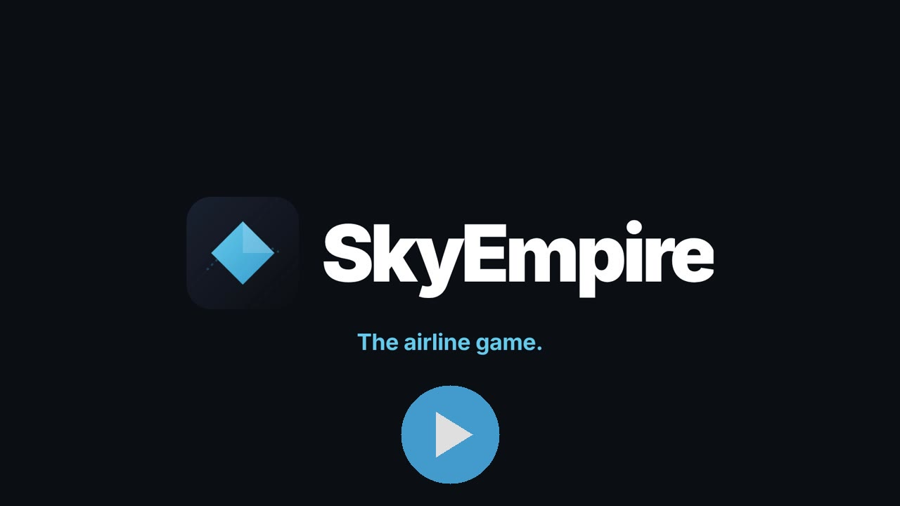

# SkyEmpire ✈️

> Start your own airline. Grow it. Beat the incumbents.

<p align="center">
  <a href="https://github.com/saurabhwebdev/skyempire/blob/main/docs/media/skyempire-trailer.mp4">
    
  </a>
  <br>
  <sub>▶ <a href="https://github.com/saurabhwebdev/skyempire/blob/main/docs/media/skyempire-trailer.mp4">Watch the 45-second trailer</a> · Music: “Uplifting Corporate” by Soundrider/Dope (CC BY)</sub>
</p>

A free, open-source airline-management game for Windows. Found an airline with $50M and a dream, lease your first A320neo, build a network across ~1,000 real airports, and take on 19 real rival airlines — Emirates, IndiGo, Lufthansa, Ryanair, Delta and more — in a world with real demand, real aircraft and real costs.

**Status:** v0.3 "Hangar" — single-player; works offline.

## Features

- **The whole world** — ~1,000 airports from OurAirports, demand calibrated against real city-pair traffic.
- **38 real aircraft** — ATR 42 to A380, each with a real photo (Wikimedia Commons), real-world specs and a seat map; lease, buy new or buy used (some classics are used-only); design your own cabin.
- **Real rival airlines** — 19 per game, picked from 145 real airlines: the incumbents near your hub plus global majors. Each flies like its real self: low-cost, network or super-connector.
- **Living economy** — fuel price swings, recessions, strikes, storms, airport expansions; slots, bases, loans, credit ratings.
- **A living world** — real and simulated weather (snow, fog, storms, cyclones) that delays and cancels flights; airspace closures that force detours; route bans and travel advisories; real holidays and festivals that fill planes.
- **Grow your airline** — Startup → Regional → National → Global, with goals along the way.
- **Real logos (optional)** — *Settings → Download real logos* fetches airline logos from Wikimedia Commons onto your PC for personal use.
- **Modern, minimal interface** — map-first, keyboard-friendly (press `?` in game), reduced-motion and colour-blind options.

## Install (Windows)

1. Download `SkyEmpire-<version>-x64.exe` from [Releases](../../releases).
2. Run it. Windows may show **"Windows protected your PC"** because the installer isn't code-signed yet — click **More info → Run anyway**.
3. When a new version is out, the game shows a banner: click **Update now**, then **Restart now**. Your game is saved first. (The .zip version links to the download instead.)

Saves live in `%APPDATA%\SkyEmpire\saves`.

## How to play (the first five minutes)

1. **New career** → name your airline → pick a home hub → pick a difficulty.
2. **Lease** an aircraft (an A320neo or 737-8 is a solid start).
3. **Open a route** from your hub: press `N`, pick a destination 500–2,000 km away, keep the suggested fare.
4. Press **Space** to play. Watch cash, load factor and the Overview alerts.
5. Grow: more aircraft, more routes, a second base — and keep an eye on your rivals in **Market**.

## Build from source

Requires Node 22 and pnpm 9.

```bash
pnpm install
pnpm --filter @skyempire/desktop dev        # run the game
pnpm test                                    # unit tests
pnpm --filter @skyempire/sim test:balance    # slow economy balance tests (~3 min)
pnpm --filter @skyempire/desktop e2e         # end-to-end tests (Linux: xvfb-run -a …)
pnpm --filter @skyempire/desktop dist        # build an installer for this OS
```

Windows installers are built by GitHub Actions (`.github/workflows/release.yml`) when a `v*` tag is pushed.

| Package | What's inside |
|---|---|
| `packages/sim` | The game engine: demand, passenger choice, costs, AI airlines, events — pure, deterministic TypeScript |
| `packages/data` | Airports, aircraft, airlines and the scripts that build them from open data |
| `packages/ui` | Design tokens and components |
| `apps/desktop` | The Electron app (main process, simulation worker, React UI) |

Design docs: [game design](docs/superpowers/specs/2026-11-13-skyempire-design.md) · [simulation](docs/simulation-spec.md) · [architecture](docs/technical-architecture.md) · [UI/UX](docs/ui-ux-design.md) · [roadmap](docs/roadmap.md)

## Legal

SkyEmpire is not affiliated with any airline or aircraft manufacturer. Names are used for identification only. Airline logos are not distributed with the game. Data sources and licenses: [CREDITS.md](CREDITS.md).

Code: [MIT](LICENSE).
